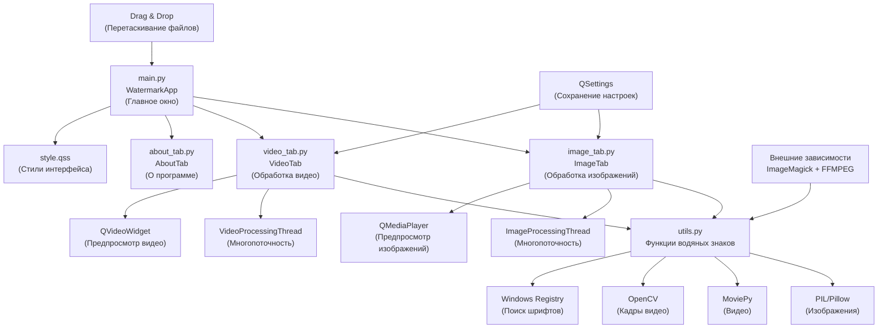

# ExMark - Пакетное наложение водяных знаков

## 📁 Структура проекта

```
├── main.py                 # Главный файл приложения (точка входа)
├── requirements.txt        # Зависимости Python
├── style.qss              # Файл стилей интерфейса
├── utils.py               # Утилиты для обработки водяных знаков
├── image_tab.py           # Модуль обработки изображений
├── video_tab.py           # Модуль обработки видео
├── about_tab.py           # Модуль информации о программе
└── resources/             # Ресурсы приложения
    ├── icon.ico           # Иконка приложения (Windows)
    └── icon.png           # Иконка приложения (универсальная)
```

## 📄 Описание файлов

### 🚀 main.py
**Назначение:** Точка входа приложения, главное окно и координация компонентов.

**Ключевые функции/классы:**
- `WatermarkApp(QMainWindow)` - главный класс приложения
- `init_ui()` - инициализация пользовательского интерфейса
- `dragEnterEvent()`, `dropEvent()` - поддержка drag & drop
- `parse_dropped_paths()` - анализ перетащенных файлов
- `load_stylesheet()` - загрузка CSS стилей

**Связи с другими файлами:**
- Импортирует модули: `image_tab`, `video_tab`, `about_tab`
- Использует `style.qss` для стилизации
- Загружает иконки из папки `resources/`

**Логика:**
Создаёт вкладочный интерфейс с тремя разделами, обрабатывает перетаскивание файлов и автоматически направляет их в соответствующие вкладки по расширению.

### 🛠️ utils.py
**Назначение:** Ядро обработки водяных знаков, содержит все алгоритмы наложения.

**Ключевые функции/классы:**
- `WatermarkParams` - структура данных для параметров водяного знака
- `apply_watermark_to_pillow_image()` - наложение водяного знака на изображение
- `process_image_file()` - обработка файла изображения
- `add_watermark_video()` - добавление водяного знака к видео
- `find_font_file_on_windows()` - поиск шрифтов в реестре Windows
- `get_watermark_position()` - расчёт позиции водяного знака

**Связи с другими файлами:**
- Используется в `image_tab.py` и `video_tab.py`
- Не зависит от UI компонентов

**Логика:**
Универсальная библиотека для работы с водяными знаками. Поддерживает текстовые и графические водяные знаки, различные позиции, прозрачность и масштабирование.

### 🖼️ image_tab.py
**Назначение:** Интерфейс и логика для обработки изображений.

**Ключевые функции/классы:**
- `ImageTab(QWidget)` - главный виджет вкладки
- `ImageProcessingThread(QThread)` - поток для обработки изображений
- `init_text_controls()` / `init_image_controls()` - инициализация элементов управления
- `apply_watermark_to_all()` - пакетная обработка изображений
- `trigger_preview_update()` - обновление предпросмотра

**Связи с другими файлами:**
- Импортирует функции из `utils.py`
- Использует `QSettings` для сохранения настроек
- Поддерживает форматы: PNG, JPG, JPEG, BMP, GIF

**Логика:**
Предоставляет интуитивный интерфейс для настройки водяных знаков с предпросмотром в реальном времени. Поддерживает многопоточную обработку для производительности.

### 🎬 video_tab.py
**Назначение:** Интерфейс и логика для обработки видео.

**Ключевые функции/классы:**
- `VideoTab(QWidget)` - главный виджет вкладки
- `VideoProcessingThread(QThread)` - поток для обработки видео
- `update_video_preview_frame()` - обновление кадра предпросмотра
- `apply_watermark_vid()` - пакетная обработка видео
- Встроенный медиаплеер с элементами управления

**Связи с другими файлами:**
- Импортирует функции из `utils.py`
- Использует OpenCV для извлечения кадров
- Поддерживает форматы: MP4, AVI, MOV, MKV, WEBM

**Логика:**
Комбинирует медиаплеер для предпросмотра с настройками водяных знаков. Использует OpenCV для извлечения кадров и отображения предпросмотра с водяным знаком.

### ℹ️ about_tab.py
**Назначение:** Информационная страница о программе.

**Ключевые функции/классы:**
- `AboutTab(QWidget)` - виджет информационной вкладки
- Контактная информация и ссылки

**Связи с другими файлами:**
- Автономный модуль без зависимостей от других частей проекта

**Логика:**
Статичная информационная страница с данными о программе, версии и контактах разработчика.

### 🎨 style.qss
**Назначение:** Стилизация пользовательского интерфейса.

**Ключевые элементы:**
- Тёмная тема оформления (#2c3e50, #34495e)
- Стили для вкладок, кнопок, полей ввода
- Анимации для drag & drop
- Настройка слайдеров и прогресс-баров

**Связи с другими файлами:**
- Загружается в `main.py` через `load_stylesheet()`

### 📋 requirements.txt
**Назначение:** Список зависимостей Python.

**Библиотеки:**
- `PyQt6` - GUI фреймворк
- `Pillow` - обработка изображений
- `moviepy==1.0.3` - обработка видео
- `opencv-python` - компьютерное зрение

## 🏗️ Архитектура проекта

### Общая структура
Приложение построено по модульной архитектуре с разделением ответственности:



### Потоки данных

1. **Ввод файлов:**
   - Drag & Drop → `main.py` → распределение по типам файлов
   - Диалог выбора файлов → соответствующие вкладки

2. **Обработка:**
   - Настройки UI → `WatermarkParams` → `utils.py` → результат
   - Многопоточная обработка через `QThread`

3. **Предпросмотр:**
   - Параметры → `apply_watermark_to_pillow_image()` → обновление UI

## 📚 Библиотеки и фреймворки

### PyQt6
**Назначение:** Основной GUI фреймворк для создания интерфейса.
**Где используется:**
- `main.py` - создание главного окна, вкладок, drag & drop
- `image_tab.py`, `video_tab.py` - элементы управления, многопоточность
- `about_tab.py` - информационная страница

### Pillow (PIL)
**Назначение:** Обработка и манипуляция изображениями.
**Где используется:**
- `utils.py` - наложение водяных знаков, работа со шрифтами
- `image_tab.py` - предпросмотр изображений
- `video_tab.py` - обработка кадров видео

### MoviePy
**Назначение:** Редактирование и обработка видеофайлов.
**Где используется:**
- `utils.py` - добавление водяных знаков к видео, прогресс-бар

### OpenCV (cv2)
**Назначение:** Извлечение кадров из видео для предпросмотра.
**Где используется:**
- `video_tab.py` - получение конкретных кадров для показа в интерфейсе

## 🎯 Точка входа и запуск

### Как запускается проект
```bash
python main.py
```

### Последовательность выполнения:
1. **Инициализация приложения** (`main.py:109-113`)
   ```python
   app = QApplication(sys.argv)
   load_stylesheet(app)
   window = WatermarkApp()
   window.show()
   ```

2. **Создание главного окна** (`WatermarkApp.__init__`)
   - Настройка логирования
   - Инициализация UI (вкладки, элементы управления)
   - Подключение обработчиков drag & drop

3. **Инициализация вкладок**
   - `ImageTab` - настройка элементов управления изображениями
   - `VideoTab` - настройка элементов управления видео + медиаплеер
   - `AboutTab` - информационная страница

4. **Загрузка настроек** (QSettings)
   - Восстановление пользовательских настроек из реестра

### Требования к системе:
- **ImageMagick** - для обработки изображений
- **FFMPEG** - для обработки видео
- Оба должны быть добавлены в системную переменную PATH

## 🔧 Архитектурные особенности

### Нестандартные решения

1. **Поиск шрифтов через реестр Windows**
   ```python
   def find_font_file_on_windows(font_name: str) -> str | None:
       # Обращение к реестру для поиска шрифтов
   ```
   **Причина:** Обеспечение кроссплатформенности и правильного отображения шрифтов.

2. **Комбинированный предпросмотр видео**
   - Использование `QMediaPlayer` для воспроизведения
   - OpenCV для извлечения кадров с водяными знаками
   **Причина:** QMediaPlayer не может отображать эффекты в реальном времени.

3. **Многопоточная архитектура**
   ```python
   class ImageProcessingThread(QThread):
       # Обработка в отдельном потоке
   ```
   **Причина:** Предотвращение блокировки UI во время длительной обработки.

4. **Универсальный WatermarkParams**
   ```python
   WatermarkParams = namedtuple("WatermarkParams", [...])
   ```
   **Причина:** Единый интерфейс для передачи параметров между модулями.

### Причины выбора архитектуры

1. **Модульность:** Каждая вкладка - отдельный модуль для лёгкого расширения
2. **Переиспользование:** `utils.py` содержит универсальные функции для обеих вкладок
3. **Производительность:** Многопоточность для обработки файлов
4. **Пользовательский опыт:** Предпросмотр в реальном времени, drag & drop
5. **Масштабируемость:** Легко добавить новые форматы или типы водяных знаков

## 🚀 Использование

1. **Запустите приложение:** `python main.py`
2. **Выберите тип медиа:** вкладка "Изображения" или "Видео"
3. **Настройте водяной знак:** текст или изображение, позиция, прозрачность
4. **Добавьте файлы:** перетащите или используйте кнопку выбора
5. **Предпросмотр:** настройки применяются в реальном времени
6. **Обработка:** нажмите "Применить ко всем" и выберите папку сохранения

## 📝 Технические характеристики

- **Язык:** Python 3.8+
- **GUI Framework:** PyQt6
- **Поддерживаемые форматы изображений:** PNG, JPG, JPEG, BMP, GIF
- **Поддерживаемые форматы видео:** MP4, AVI, MOV, MKV, WEBM
- **Платформа:** Windows (с поддержкой других ОС при наличии зависимостей)
- **Внешние зависимости:** ImageMagick, FFMPEG

---

Автор: legenda  
Telegram: [@LEGENDA_SD](https://t.me/LEGENDA_SD)
